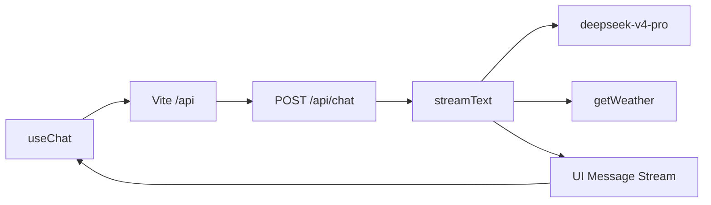

# Vercel AI SDK 专栏代码示例

本仓库是 [Vercel AI SDK 专栏](https://agent-docs.dev/docs/ai-agent/vercel-ai-sdk/) 的配套代码。专栏从第一个流式对话讲到可运营应用，覆盖三层架构、Provider 生态、流式 UI、Tool Calling、Agent 编排、MCP、RAG、RSC、AI Gateway、多模态与生产工程化。

示例按专栏顺序编号，每个目录都可以单独安装、单独运行。当前版本以 **AI SDK 7**（`ai`）为准，前端示例使用 React 19。

## 当前示例

| 目录 | 对应能力 | 你会看到 |
| --- | --- | --- |
| [`01-ai-sdk-stream-demo`](./01-ai-sdk-stream-demo) | Core + UI + Provider + Tool Calling | DeepSeek 流式对话、模拟天气工具、有限步 Agent 循环 |

### 运行 `01-ai-sdk-stream-demo`

```bash
cd 01-ai-sdk-stream-demo
cp .env.example .env
pnpm install
```

在 `.env` 中填入 `DEEPSEEK_API_KEY`，然后开两个终端：

```bash
pnpm dev:server   # Hono，http://127.0.0.1:3001
pnpm dev:client   # Vite，http://127.0.0.1:5173
```

浏览器打开 `http://127.0.0.1:5173`。Vite 把 `/api` 代理到 3001。问「北京天气」时，模型会调用 `getWeather`，界面按工具状态渲染结果。

一次请求的路径：



## 三层架构

AI SDK 把「调用模型」「驱动界面」「在服务端直接流出界面」拆成三层。换模型时，这三层的调用方式保持不变。

| 层 | 包 | 运行位置 | 职责 |
| --- | --- | --- | --- |
| **AI SDK Core** | `ai` | 服务端、脚本、Agent 运行时 | 统一的文本、结构化输出、工具、嵌入、图像、语音、视频 API |
| **AI SDK UI** | `@ai-sdk/react`、`vue`、`svelte`、`angular` | 浏览器 | 管理输入、消息、状态，消费流式协议并渲染 |
| **AI SDK RSC** | `ai/rsc` | React Server Components | 在服务端生成并流式传输 React 组件 |

Core 是另外两层的底座。`01` 已经接上 Core 和 UI：`src/server.ts` 调用 `streamText`，`src/App.tsx` 用 `useChat` 消费同一条 UI Message Stream。RSC 是第三条路径，适合在 Server Component 里直接流出界面；新项目优先走 UI 层，再用结构化数据在客户端渲染界面。

官方文档在这三层之外还提供 **AI SDK Harnesses**：用 `HarnessAgent` 以同一套流式原语接入 Claude Code、Codex、Pi 等既有 Agent 运行时。Harness 复用 Core 的响应形态，也能够被 UI 层消费。专栏后半把它单独成章。

## Provider 生态

Provider 把各家模型 API 收成同一种语言模型规范。应用代码依赖 `streamText` / `generateText` 和 `LanguageModel`，模型差异留在 Provider 包里。

- **官方 Provider**：`@ai-sdk/openai`、`@ai-sdk/anthropic`、`@ai-sdk/google`、`@ai-sdk/azure`、`@ai-sdk/amazon-bedrock`、`@ai-sdk/mistral`、`@ai-sdk/groq`、`@ai-sdk/deepseek`、`@ai-sdk/xai` 等。
- **OpenAI 兼容入口**：对接自建网关、LM Studio，以及任何实现 OpenAI 接口的服务。
- **社区 Provider**：Ollama、OpenRouter、Cloudflare Workers AI 等，遵循同一套规范即可替换。

`01` 使用：

```ts
import { deepSeek } from '@ai-sdk/deepseek'

streamText({
  model: deepSeek('deepseek-v4-pro'),
  // messages、tools、stopWhen 与具体厂商无关
})
```

换成另一个官方 Provider 时，改的是模型实例和密钥，消息、工具和 UI 协议保持原样。选型时要核对能力，而不是只看模型名字：`deepseek-v4-pro` 支持工具调用和结构化输出，不接受图像输入。图像、语音、视频要选对应模态的模型和 Provider。

## 流式 UI

流式 UI 解决的是「模型还在生成时，界面如何持续更新」。Core 负责产出流，UI 层负责把流变成可交互状态。

1. 服务端 `streamText` 得到流式结果，用 `toUIMessageStreamResponse()` 输出 **UI Message Stream**。
2. 浏览器里的 `DefaultChatTransport` 把请求发到 `/api/chat`。
3. `useChat` 维护 `messages`、`status`（`submitted` / `streaming`）、`error`，并提供 `sendMessage`、`stop`、`regenerate`。

消息在两侧各有一种形态：

- **UIMessage**：界面状态。一条消息由 `parts` 组成，文本、工具、文件、推理、自定义数据各自是一种 part。`01` 渲染 `text` 和 `tool-getWeather`。
- **ModelMessage**：模型上下文。服务端用 `convertToModelMessages` 把 UIMessage 转成模型能读的消息，再用 `validateUIMessages` 拒绝非法结构。

系统提示放在服务端的 `instructions` 里。`01` 会拒绝客户端提交的 `system` 消息，避免用户覆盖人设和安全约束。

聊天之外还有两种交互：`useCompletion` 做单轮补全，`useObject` 把结构化对象流直接绑定到界面。自定义业务事件可以走同一条流的 data part，和正文分开渲染。

## Tool Calling

工具是一组带 Schema 的函数。模型根据描述决定是否调用、传入什么参数；SDK 校验参数并执行，再把结果送回模型。

`01` 里的天气工具是最小闭环：

```ts
tool({
  description: '返回指定城市的模拟天气，用于演示，不能作为实时天气依据',
  inputSchema: z.object({
    city: z.string().describe('中文城市名，例如北京'),
  }),
  execute: async ({ city }) => ({ city, temperature: 25, condition: '晴' }),
})
```

要点：

- `description` 和字段描述决定模型会不会选对工具、会不会填对参数。
- `inputSchema` 用 Zod 做运行时校验，并推断 TypeScript 类型。
- 执行结果回到模型后，模型再用自然语言回答。界面上的 part 类型是 `tool-getWeather`，状态包括调用中、`output-available`、`output-error`、`output-denied`。
- 多步调用由 `stopWhen` 截断。`isStepCount(3)` 表示模型与工具来回最多 3 步，防止无限循环。
- 有副作用或花钱的工具应加上审批：模型提出调用，用户确认后才 `execute`。`01` 的天气工具是只读模拟数据，因此直接执行。

工具还可以动态注册、按检索结果装载，或把执行放进带权限边界的沙箱。这些是同一套 `tool()` 往生产方向的延伸。

## Agent 编排

Agent 是「模型 + 工具 + 停止条件 + 可恢复状态」的循环，不是另一个聊天接口。

`streamText` 加上 `tools` 和 `stopWhen` 就是最小 Agent：模型观察当前消息，决定回答或调用工具，工具结果写回上下文，直到停止条件成立。`01` 用步数作为停止条件。

再往上，编排分四种：

| 模式 | 作用 |
| --- | --- |
| 顺序 | 上一步的输出作为下一步的输入，例如检索再回答 |
| 并行 | 多个无依赖工具同时执行，缩短等待 |
| 分支 | 用分类或 `prepareStep` 在运行时更换模型、工具集或提示 |
| 多 Agent | 主 Agent 把子任务交给有独立工具和提示的子 Agent，再汇总 |

`ToolLoopAgent` 把循环、步数和工具策略收成可复用对象。需要接既有编程 Agent 时，用 `HarnessAgent` 适配 Claude Code、Codex、Pi，流式结果仍交给 `useChat`。记忆分成当前对话的短期上下文，以及跨会话检索的长期知识；上下文变长时要压缩或摘要，否则费用和延迟会随轮次上升。

## MCP

[Model Context Protocol](https://modelcontextprotocol.io) 把「工具从哪来」和「模型怎么调用」分开。MCP Server 声明工具、资源和提示；AI SDK 作为 MCP Client 连接它，把远端工具合并进 `streamText` 的 `tools`。

传输通常是 stdio（本机进程）或 Streamable HTTP（远程服务）。合并之后，模型看到的仍是普通工具：有描述、有 Schema、有执行结果。UI 层不需要知道工具来自本地函数还是 MCP。

生产里 MCP 是一条供应链：

- 认证和租户隔离，避免一个用户的连接读到另一个用户的工具。
- 工具允许列表，只暴露当前任务需要的能力。
- 对不可信 Server 做沙箱和审计，记录谁在何时调用了什么。
- 远端失败要分类处理：参数错误交给模型修正，超时和 5xx 重试或降级，权限错误直接返回给用户。

## RAG

RAG 让模型回答时带上你自己的资料，并让界面能引用出处。它由 Core 的嵌入 API 和一次普通生成组成。

1. 入库：文档切块，`embed` / `embedMany` 写成向量，连同原文和元数据存入向量库。
2. 检索：把用户问题嵌入，按相似度取回相关块。
3. 生成：把块写进提示或作为一个检索工具的返回值，让模型基于这些材料回答。
4. 引用：把块的标题、链接、片段作为 data part 或来源字段交给 UI，和正文分开展示。

检索可以发生在调用模型之前，也可以做成工具，由模型决定何时查询。工具形态更适合多轮对话：模型先判断要不要查，再带着结果继续推理。质量取决于切块、元数据过滤和评测集，而不是只换一个更大的模型。资料更新后要能增量重建索引，并在回答旁保留引用，方便核对。

## RSC

AI SDK RSC 在 React Server Components 中流式生成界面。服务端根据模型和工具结果产出 React 节点，客户端逐步把这些节点显示出来。

常用原语：

- `streamUI`：把一次生成变成可流式传输的 React 树，工具可以返回组件。
- `createAI`、`useUIState`、`useActions`：在服务端保存 AI 状态，在客户端触发 Server Action。
- `createStreamableValue`：流式传输数字、字符串等普通值，适合进度和局部文本。

加载态用初始组件占位，错误用 Error Boundary 接住，身份信息在 Server Action 里校验，不从客户端消息里信任。状态通过 `onGetUIState` / `onSetAIState` 保存和恢复。

专栏后半给出迁移路径：生成式界面改由 UI 层承载，服务端返回结构化数据和工具结果，客户端按 part 渲染组件。这样界面可以在 React、Vue、Svelte 之间复用同一条流，也避免把组件序列化进模型上下文。

## AI Gateway

AI Gateway 是 Provider 前面的路由层。应用仍然调用 `generateText` / `streamText`，模型写成带厂商前缀的名字，由网关选择具体供应商。

它解决四件事：

- **一个入口访问多家模型**，应用不必为每个厂商各写一套鉴权和 SDK。
- **供应商路由**：`providerOptions.gateway` 的 `order`、`only`、`sort` 控制优先顺序、允许名单，以及按延迟或价格排序。
- **模型降级**：主模型失败后按 `models` 列表尝试备用模型。
- **成本和观测**：统一查看用量、延迟和失败原因，并用自带密钥（BYOK）或平台凭证调用。

`01` 目前直连 `@ai-sdk/deepseek`，方便对照 Provider 本身。需要多模型容灾或统一账单时，把 `model` 换成 Gateway 的模型标识，消息、工具和 UI 流保持不变。路由策略放在服务端，不交给浏览器。

## 多模态

多模态是同一套消息和生成 API 上的不同 part、不同函数。

| 能力 | Core API | 在消息里的形态 |
| --- | --- | --- |
| 图像理解 | 支持视觉的语言模型 | 用户消息中的 image / file part |
| 图像生成 | `generateImage` | 生成文件，或写入界面 part |
| 向量 | `embed`、`embedMany` | 不进聊天流，供检索使用 |
| 语音合成 | `generateSpeech` | 音频文件 |
| 语音转写 | `transcribe` | 文本，再进入对话 |
| 视频生成 | `generateVideo` | 生成文件与封面 |
| 实时语音 | Realtime / WebSocket | 独立传输，不是 UI Message Stream |

文件很大时使用 Provider 侧的文件引用，避免把二进制反复塞进上下文。选用模型前先看能力表：当前示例的 `deepseek-v4-pro` 可以调用工具，不能读图。读图需要换一个带 Image Input 的模型，UI 侧增加文件 part 即可，`useChat` 的提交流程不变。

## 生产工程化

能跑通对话之后，生产要管住时间、权限、质量和成本。`01` 已经放进了第一批约束，其余按专栏的生产章补齐。

**请求生命周期**

- `timeout` 限制单次模型调用；`stop` 让用户取消客户端上的流。
- `maxRetries` 控制 SDK 自动重试。示例里设为 `0`，失败立即可见。
- `maxOutputTokens` 限制单次输出长度。
- 写操作和扣费用幂等键，重试不能重复下单或重复发送。

**边界**

- `validateUIMessages` 校验入参；系统提示只存在于服务端。
- 工具按权限暴露，危险操作走审批，执行记录可审计。
- 提示注入会试图让模型忽略 `instructions` 或调用越权工具。系统提示、检索内容和工具结果要分区，工具本身再做授权，不能只靠提示词。
- 返回给浏览器的错误用固定文案，细节打在服务端日志里。`toUIMessageStreamResponse` 的 `onError` 就是这层脱敏。

**运行**

- 限流、排队、按用户去重，避免重试风暴打满供应商配额。
- OpenTelemetry 接通 AI SDK 的 telemetry，把一次对话的模型、工具、令牌和延迟串成一条链路。
- 提示词、模型和工具集要有版本，实验可回滚。
- 用固定评测集回归输出质量；RAG 同时评检索命中和引用是否支持答案。
- 为每次会话设置令牌预算，能缓存的系统提示和工具定义不要每步重发。

## 和专栏的对应关系

专栏目录会继续调整，章节顺序以 [专栏页面](https://agent-docs.dev/docs/ai-agent/vercel-ai-sdk/) 为准。

| 专栏 | 本仓库中的落点 |
| --- | --- |
| 第一章 基础入门 | 本文的三层架构、Provider，以及 `01` 的第一条流式对话 |
| 第二章 AI SDK Core | `01` 的 `streamText`、`instructions`、`stopWhen`、`timeout` |
| 第三章 AI SDK UI | `01` 的 `useChat`、UIMessage parts、停止与重试 |
| 工具与 MCP | `01` 的 `getWeather`；MCP 客户端与审批在后续示例 |
| AI SDK RSC | 本文 RSC 一节；独立示例随后补充 |
| Agent 系统 / Harnesses | `01` 的有限步循环；`ToolLoopAgent` 与 `HarnessAgent` 随后补充 |
| 图片、视频和向量 | 本文多模态与 RAG 中的嵌入；独立示例随后补充 |
| Skills | 可复用的指令、工具和知识包，建立在工具与 Agent 之上 |
| 生产工程化 | `01` 的校验、超时、错误脱敏；Gateway、遥测和评测随后补充 |

建议顺着专栏读：先跑通 `01`，确认 UIMessage、模型消息和工具 part 三条线，再进入结构化输出、审批、MCP 和 RAG。
